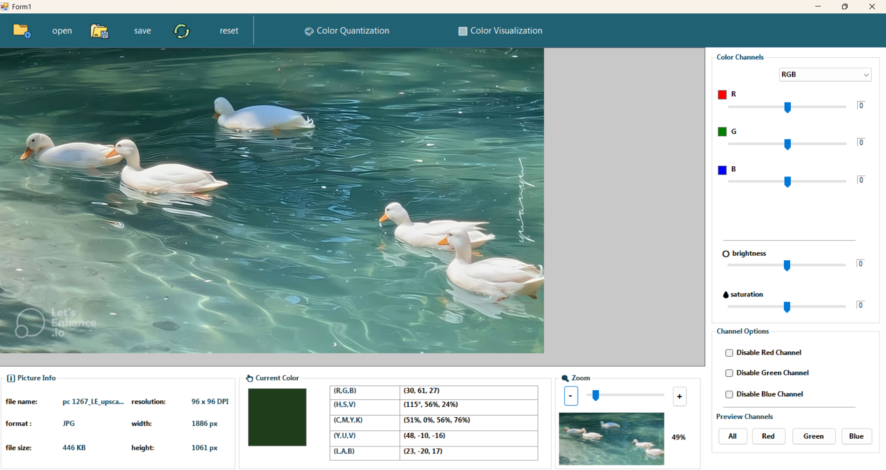
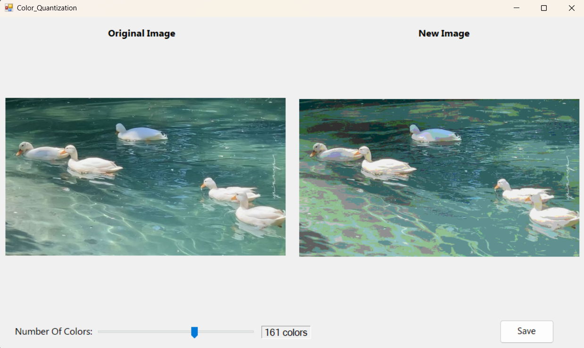
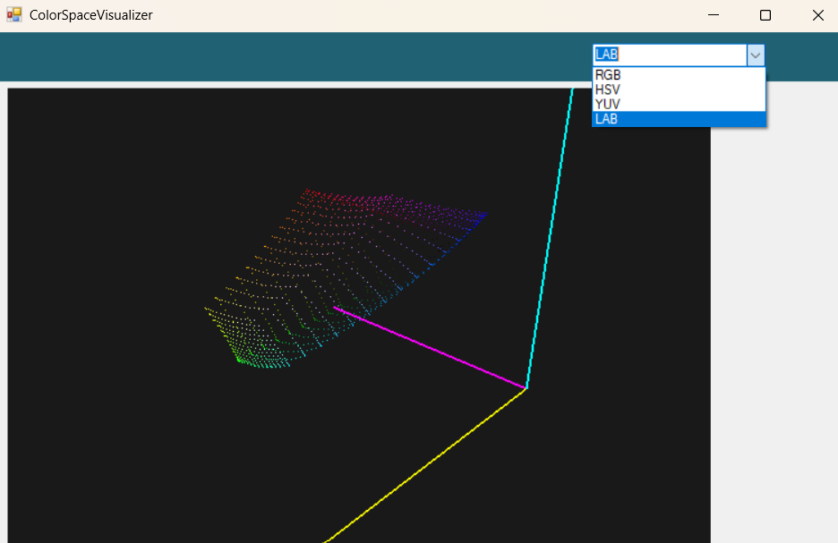
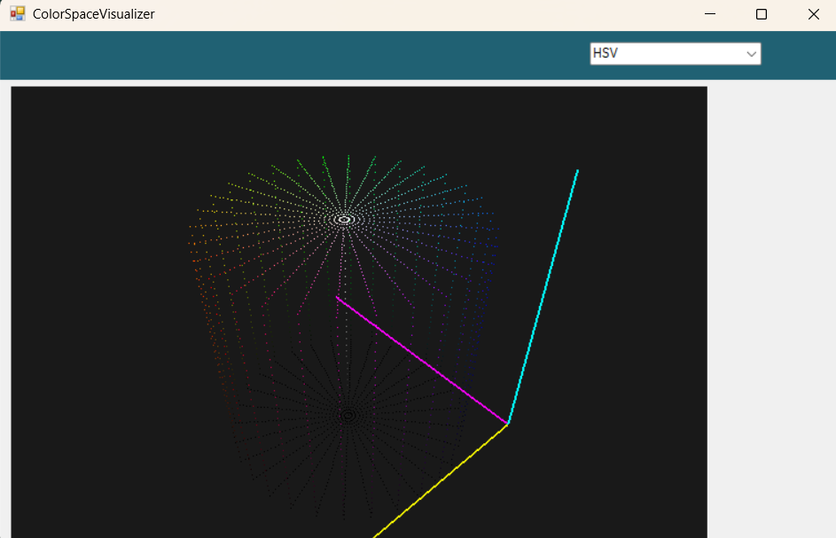

<h1 align="center">🎨 PixelLab</h1>

<p align="center">
  An interactive desktop app for exploring image processing and color spaces in real time
</p>

<p align="center">
  
  
  
  
</p>

---

## 📖 About

**PixelLab** is an educational Windows desktop application built with **C#** and **Windows Forms**. It makes image processing and color system concepts easy to understand through a clean, interactive interface that updates in real time.

Users can load an image, convert it between color spaces, adjust each channel, reduce its colors, and explore color spaces visually in 3D.

> 🎓 Built as a solo project for the **Multimedia Systems** course, Faculty of Information Engineering, Damascus University (2024–2025).

---

## 📸 Screenshots

### Main Window
<p align="center">
  
</p>

### Color Quantization
<p align="center">
  
</p>

### 3D Color Space Visualizer
<p align="center">
  
  
</p>

---

## ✨ Features

- 📂 **Open images** (JPG, PNG, BMP) with a file dialog or by **drag & drop**
- 🔄 **Color space conversion** between RGB, HSV, CMYK, YUV, YCbCr, and LAB
- 🎚️ **Channel sliders** that rename and recolor themselves based on the selected color space
- ☀️ **Brightness and saturation** controls that work in every color space
- 🚫 **Disable channels** (R, G, B) individually, or **preview a single channel**
- 🎯 **Color picker**: click any pixel to see its values in RGB, HSV, CMYK, YUV, and LAB
- 🧊 **3D color space visualizer** for RGB (cube), HSV (cylinder), YUV, and LAB, with mouse rotation and scroll zoom
- 🎨 **Color quantization**: reduce an image to anywhere from 2 to 256 colors and compare it side by side with the original
- ℹ️ **Image info**: file name, format, size, resolution (DPI), width, and height
- 🔍 **Zoom** with a live thumbnail preview
- ♻️ **Reset** to restore the original image and all settings
- 💾 **Save** the edited image as PNG, JPEG, or BMP

---

## 🛠️ Technical Highlights

- **Fast, real-time editing:** uses `LockBits` instead of `GetPixel`/`SetPixel`, locking the image once rather than per pixel, so changes apply instantly even on large images.
- **RGB as the bridge:** every conversion passes through RGB (LAB goes RGB → XYZ → LAB), with clamping to keep values in the valid 0–255 range.
- **Non-destructive editing:** the original image is kept untouched, while a separate copy is used for edits and display.
- **Saturation formula:**
  ```
  gray = (R + G + B) / 3
  R'   = gray + (R − gray) × (1 + saturation)
  ```
  `0` = no change, `> 0` = more vivid, `−1` = full grayscale
- **Quantization algorithm:** calculates `step = ∛(256 / colorCount)` and rounds each channel value to the nearest multiple of the step.
- **3D rendering with OpenTK 3.3.3:** perspective projection, depth testing, and mouse events for rotation and zoom.

---

## 📁 Project Structure

```
PixelLab/
├── Forms/                       # Main UI forms
├── Services/
│   ├── ColorConvert.cs          # Color space conversion functions
│   ├── ImageProcessor.cs        # Image processing and adjustments
│   └── ColorQuantizate.cs       # Color reduction (quantization)
└── Helpers/
    └── ZoomHelper.cs            # Zoom calculations
```

---

## 🚀 Getting Started

### Requirements
- Windows
- [Visual Studio](https://visualstudio.microsoft.com/) with the **.NET desktop development** workload
- .NET Framework 4.7.2

### Run the project
1. Clone the repository
   ```bash
   git clone https://github.com/Elissar-o29/PixelLab.git
   ```
2. Open the `.sln` file in Visual Studio
3. Restore NuGet packages (right-click the solution → **Restore NuGet Packages**) to install OpenTK
4. Press **F5** to build and run

---

<p align="center">
  Made with 💜 by <a href="https://github.com/Elissar-o29">Elissar Al-Ali</a>
</p>
